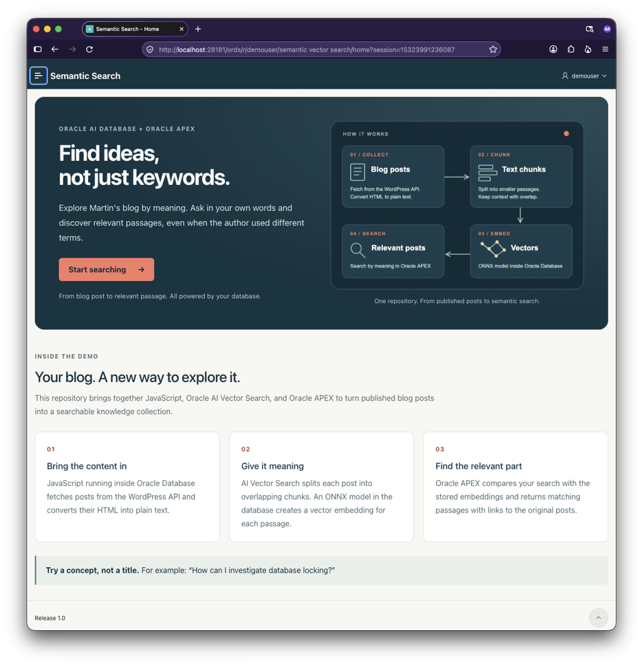

# Semantic Search

This demo uses Oracle AI Database 26ai, JavaScript Multilingual Engine (MLE), AI Vector Search and Oracle APEX to search posts from [martincarstenbach.com](https://martincarstenbach.com/) by meaning. It fetches WordPress posts, converts HTML to plain text, stores the posts, and creates chunk embeddings with the database's ONNX model `all_MiniLM_L12_v2` stored as `DOC_MODEL`.



## Application pages

The APEX application consists of the following pages:

| Page | Purpose |
| --- | --- |
| 1 — Home | Introduces the demo and links to search. |
| 2 — Semantic Search | Searches matching passages and links to the original blog posts. |
| 3 — Blog Refresh | Checks source changes, reports chunk counts and refreshes suggested posts in the background. |

The app uses Oracle APEX Accounts authentication. Blog Refresh has no additional maintenance role restriction.

> [!WARNING]
> This repository is a lab/demo setup! It has not been properly vetted for production use.

## Current release and source layout

[SQLcl Projects](https://docs.oracle.com/en/database/oracle/sql-developer-command-line/26.3/sqcug/database-application-cicd.html) release **1.0.3** contains the incremental refresh schema, updated
MLE bundle, environment mappings and singleton seed. Updated APEX SQL exports are included in the release hierarchy. The default deployment now uses application **101**, workspace **DEMOUSER** and parsing schema **DEMOUSER**.

| Location | Purpose |
| --- | --- |
| `src/javascript/fetchPosts.js` | Editable ingestion/refresh implementation, Logger tracing and JSDoc. |
| `src/database/demouser/` | Exported database objects relevant to the application; regenerate through the development/export workflow. |
| `src/database/demouser/apex_apps/f101/readable/` | APEXlang source, including Page 3, navigation and static assets. |
| `src/database/demouser/apex_apps/f101/f101.sql` | SQL application export. |
| `dist/` | Versioned SQLcl Projects changesets and application/ORDS deployment exports. |
| `.dbtools/` | SQLcl project configuration, export filters and formatting rules. |
| `setup/` | _Local_ container initialization scripts for outbound HTTP access and the model directory. |

The source declares APEXlang **26.1.0+3102** and SQLcl **26.3.1.0**.

Updating the code in `src/javascript/fetchPosts.js` requires a rebuild of the bundle module using `esbuild`. Use `npm run build` to do that.

## Prerequisites

- Oracle AI Database 26ai with MLE, AI Vector Search and Oracle Text available. The intended cloud target is Autonomous AI Database 26ai; a local Compose setup is also supplied.
- Oracle APEX 26.1 or later with JavaScript MLE and background page processing available.
- SQLcl compatible with the checked-in project configuration.
- Node.js and npm to bundle the JavaScript dependencies for development.
- OraOpenSource Logger installed in schema `LOGGER`, accessible to `DEMOUSER`.
- The augmented `all_MiniLM_L12_v2.onnx` model loaded as `DEMOUSER.DOC_MODEL`, provided via `setup/02_ai_model.sql` or alternatively via `dbms_cloud`.
- Database outbound HTTPS access to `public-api.wordpress.com`, facilitated via `setup/01_ace.sql` or `dbms_cloud`.

## Deploying against Oracle AI Autonomous Database

On Autonomous Database, APEX and ORDS are provided by the service. Create the application owner as an administrator. The following is the existing lab privilege recipe, rather than a minimal production role definition.

### Create the DEMOUSER account

Connect to the ADB-S instance as `ADMIN`, then create the user:

```sql
create user demouser identified by "<choose-a-schema-password>"
default tablespace users
quota 1g on users;

grant CREATE SEQUENCE to DEMOUSER;
grant CREATE ASSERTION to DEMOUSER;
grant CREATE DOMAIN to DEMOUSER;
grant CREATE JOB to DEMOUSER;
grant CREATE MINING MODEL to DEMOUSER;
grant CREATE MLE to DEMOUSER;
grant CREATE SESSION to DEMOUSER;
grant DEBUG CONNECT SESSION to DEMOUSER;
grant EXECUTE DYNAMIC MLE to DEMOUSER;
grant FORCE TRANSACTION to DEMOUSER;
grant CREATE CLUSTER to DEMOUSER;
grant CREATE MATERIALIZED VIEW to DEMOUSER;
grant CREATE OPERATOR to DEMOUSER;
grant CREATE PROCEDURE to DEMOUSER;
grant CREATE PROPERTY GRAPH to DEMOUSER;
grant CREATE SYNONYM to DEMOUSER;
grant CREATE TABLE to DEMOUSER;
grant CREATE TRIGGER to DEMOUSER;
grant CREATE TYPE to DEMOUSER;
grant CREATE VIEW to DEMOUSER;
```

This will become the parsing schema for the APEX application.

### Create the network ACE

Before the database can reach Wordpress it must be granted outbound network traffic. Use the example in `setup/01_ace.sql` to allow DEMOUSER to reach Wordpress.

### Load the ONNX model into ADB-S

Before you can create the ONNX model in the database you need to upload it to object storage in OCI. Start by creating a new bucket; skip this step if you have a suitable bucket already. The following instructions use the [OCI CLI](https://docs.oracle.com/en-us/iaas/Content/API/Concepts/cliconcepts.htm) to do so, alternatively use the browser interface.

```sh
oci os bucket create \
  --profile DEFAULT \
  --region ${YOUR_REGION} \
  --compartment-id ${COMPARTMENT_OCID} \
  --name 'onnx-model-bucket' \
  --public-access-type NoPublicAccess \
  --storage-tier Standard
```

Next upload the [all_MiniLM_L12_v2.onnx](https://adwc4pm.objectstorage.us-ashburn-1.oci.customer-oci.com/p/fU1V-voY2VBhhqMPjhCC57Up77ROK9u6GN_j3-uGi_EzIdHm9XDn-RfnZS5bV0cN/n/adwc4pm/b/OML-ai-models/o/Oracle%20Machine%20Learning%20AI%20models.htm) file to the storage bucket. Adjust names and paths as needed.

```sh
oci os object put \
  --profile DEFAULT \
  --region ${YOUR_REGION} \
  --bucket-name 'onnx-model-bucket' \
  --file '/path/to/all_MiniLM_L12_v2.onnx' \
  --name 'all_MiniLM_L12_v2.onnx'
```

Create an Access Token for it and use it with `DBMS_CLOUD.create_credential`.

```sh
oci iam auth-token create \
  --profile DEFAULT \
  --user-id 'ocid1.user.oc1..REPLACE_ME' \
  --description 'DBMS_CLOUD Object Storage access' \
  --query 'data.token' \
  --raw-output
```

Connect to the database as DEMOUSER, and create your credential. This assumes you use the DEFAULT identity domain, if you don't, adjust the command accordingly.

```sql
begin
    dbms_cloud.create_credential(
        credential_name => 'OCI_OBJECT_STORAGE',
        username        => 'your.name@example.com',
        password        => '<generated-auth-token>'
    );
end;
/
```

With the credential in place you can create the DOC_MODEL in the database:

```sql
declare
  model_source blob := null;
begin
    model_source := dbms_cloud.get_object(
      credential_name => 'OCI_OBJECT_STORAGE',
      object_uri => 'https://objectstorage.<region>.oraclecloud.com/n/<namespace>/b/onnx-model-bucket/o/all_MiniLM_L12_v2.onnx'
    );
  
    dbms_vector.load_onnx_model('DOC_MODEL', model_source);
end;
/
```

Use `oci os ns get` to retrieve your namespace if needed.

Verify if the model has been created using `select * from dm_user_models`.

## Local Compose setup

The current `compose.yml` selects:

- Database image `ghcr.io/gvenzl/oracle-free:23.26.4`, exposed on port 1521.
- ORDS image `container-registry.oracle.com/database/ords:26.3.1`, with HTTP on port 8080.
- Persistent volumes for database data and ORDS configuration.
- `./apex` mounted into the ORDS container and `./setup` mounted as database
  initialization scripts.

### Install ORDS and APEX in the database

Extract the APEX distribution you intend to run (either 26.1 or 26.2) into `./apex`. For example:

```sh
curl -LO https://download.oracle.com/otn_software/apex/apex_26.2_en.zip
unzip -q apex_26.2_en.zip
```

Create a local `.env` file and keep it out of source control:

```sh
ORACLE_PASSWORD='<your database administrator password>'
APP_USER_PASSWORD='<your application schema password>'
```

Start the services with Docker Compose, or adapt the invocation for your Podman setup:

```sh
docker compose up -d
```

The database creates `DEMOUSER` through its `APP_USER` setting. On first database initialization, `setup/01_ace.sql` grants that schema HTTP access to the WordPress API, and `setup/02_ai_model.sql` creates `MODEL_DIR` for `/opt/oracle/ai` with read/write grants. They do not load the model or install this project's release. Existing database volumes do not reapply initialization scripts as schema upgrades.

### Load the ONNX model into the local database

Use `deploy-local.sh` to load the model into the database.

## Common setup and installation steps

At this point, the remaining steps equally apply to the local setup and Autonomous AI Database alike.

### APEX Workspace

Ensure `DEMOUSER` has the privileges needed for the schema objects, model loading and MLE execution. Background maintenance also needs `CREATE JOB` and a working APEX background-processing setup.

Log in to the APEX administration interface. Create an APEX workspace named `DEMOUSER` using the existing `DEMOUSER` account as its parsing schema.

Review `dist/env/default.properties` before installing into a different workspace, schema or application ID. The APEXlang deployment file also specifies application 101.

### Install Logger

Install the [OraOpenSource Logger framework](https://github.com/OraOpenSource/Logger) into schema `LOGGER` using its installation instructions. The JavaScript resolves `LOGGER.LOGGER` explicitly, so no public synonym is required. As Logger's owner or an appropriately privileged administrator, grant the application schema access:

```sql
grant execute on logger.logger to demouser;
grant select on logger.logger_logs to demouser;
```

The SELECT grant supports inspecting logs directly. The exported `DEMOUSER.LOG_TABLE` is a legacy table; the current implementation logs through the Logger package instead. Verify a real Logger call works as `DEMOUSER`, not just that its FFI (Foreign Function Interface, a part of MLE/JavaScript) wrapper resolves.

### Install or upgrade the release

Connect in SQLcl as DEMOUSER, using an interactive or saved connection. Run the packaged installer (create the artifact if it isn't present):

```sql
project gen-artifact
project deploy -file artifact/semantic-search-1.0.3.zip
```

The main changelog includes releases through `1.0.3`. That release adds the source metadata/state tables, indexing baseline columns, status view, updated bundle, `blog_posts` environment mapping and rerunnable singleton seed. The updated app SQL export is included by the APEX changelog.

The seed initializes `BLOG_REFRESH_STATE.ID = 1` without resetting existing timestamps or counters. It is a custom data changeset because normal schema export does not capture seed rows; `.dbtools/filters/dml.filters` disables table-data export by default.

## Using the application

Log into the APEX application as DEMOUSER.

### Performing a semantic search

Enter a natural-language question on Page 2. Its vector search configuration uses `BLOGPOST_SEARCH_SOURCE` and the `DEMOUSER.DOC_MODEL` provider. The view joins posts to their chunks and exposes titles, links, text and embeddings. Matches represent passages, so multiple matches can belong to one post. Links open the original posts in a new tab.

### Blog Refresh

Page 3 has an index summary, a per-post chunk/status report and a background-job report. Use the actions in this order:

1. **Check for updates** fetches source metadata without generating embeddings.
   It validates pagination headers, row counts, unique IDs and UTC timestamps
   before replacing the stored snapshot. A failed/incomplete check preserves the
   previous snapshot; an unexpectedly empty collection is rejected.
2. Review the report's actual and expected chunk counts, source/indexed timestamps,
   status, refresh suggestion and last error.
3. **Refresh suggested posts** refetches each candidate's current content and
   regenerates only that post's chunks and embeddings. Current posts are skipped.
4. Follow **Background Jobs**, which polls every five seconds while the page is
   visible. Use **Reload reports** to refresh all displayed counts and outcomes.

| Status | Meaning |
| --- | --- |
| New | A checked source post has no indexed local post. |
| Changed | The source modification time differs from the indexed version. |
| Unknown | Source/indexing baseline information is missing. |
| Missing chunks | Chunk counts differ from the successful baseline, no chunks exist, or embeddings are missing. |
| Failed | A previous refresh attempt recorded an error. |
| Missing from source | A successful source check no longer finds the post; it is retained for review. |
| Current | None of the preceding conditions applies. |

Only source-present New, Changed, Unknown, Missing chunks and Failed posts are suggested for refresh. Before the first successful check, zero suggestions does not establish freshness. Legacy posts need an initial refresh to establish their indexing baselines.

`BLOGPOSTS.MODIFIED` stores the indexed source's UTC edit timestamp, not the load time. `INDEXED_AT` records successful indexing time, and `INDEXED_CHUNK_COUNT` records the expected chunk count. `BLOGPOST_SOURCE` keeps the most recent checked metadata separately; `BLOG_REFRESH_STATE` records check/refresh outcomes.

The two actions run in a serialized APEX background execution chain. Page code is MLE/JavaScript and imports `blog_posts` directly; no additional PL/SQL call specs are used. A singleton database row lock also prevents overlapping maintenance from other callers. The app uses its normal authentication without a separate maintenance access restriction.

Each post has a savepoint. If its replacement fails, the old post/chunks are restored, `LAST_ERROR` is recorded and the batch continues. A successful background operation commits once at the end; the module itself never commits. A batch-level failure rolls back the operation. Check the failed-post count and errors even when the background job finishes successfully. Missing source posts are not deleted.

The current pipeline converts titles and bodies with `html-to-text`, then calls `UTL_TO_TEXT`, `UTL_TO_CHUNKS` and `UTL_TO_EMBEDDINGS`. Chunking uses word-based `max: 200`, `overlap: 20`, recursive splitting and a 4,000-byte limit matching `CHUNK_DATA`. JSON extraction fails explicitly on conversion errors.

### Refresh from SQLcl

The existing `BLOG_POSTS_PACKAGE.REFRESHBLOGPOSTS` call specification still invokes the JavaScript export. It now checks the source and refreshes candidates incrementally. The caller owns the transaction and must commit or roll back to release the lock:

```sql
begin
    demouser.blog_posts_package.refreshblogposts;
    commit;
exception
    when others then
        rollback;
        raise;
end;
/
```

The separate JavaScript exports are `checkForUpdates()` and `refreshSuggestedPosts()`. Their optional synchronous `onProgress` callback reports phase-specific messages and counters to the APEX background process. Initial indexing may take a while.

## Development and SQLcl Projects workflow

1. Edit `src/javascript/fetchPosts.js` and the readable APEXlang source.
2. Bundle JavaScript from the repository root:

   ```sh
   npm run build
   ```

3. Connected as `DEMOUSER` in SQLcl, load the module into the development database:

   ```sql
   mle create-module -filename build/bundle.js -module-name bundle_module -replace
   ```

4. Validate and import the readable app into the intended development app/workspace:

   ```sql
   apex validate -input src/database/demouser/apex_apps/f101/readable
   apex import -input src/database/demouser/apex_apps/f101/readable
   ```

5. Test search, source checks, initial/incremental indexing, failure rollback/retry,
   lock rejection and background progress in that database/application.
6. Run `project export` from the project root against the tested development
   database. Review the regenerated schema, MLE environment/module and both APEX
   export formats; do not overwrite the editable JavaScript with an older bundle.
7. Review and commit the source changes, run `project stage`, then review and commit
   the generated changesets before `project release` and artifact generation.
   Keep seed data/custom changesets and module/environment dependencies in the
   release. Do not manually edit historical deployed changesets.

The configured saved connection name is local to the developer's machine. Select the intended connection rather than assuming the name exists elsewhere. See the [SQLcl Projects quick start](https://docs.oracle.com/en/database/oracle/sql-developer-command-line/26.3/sqcug/quick-start.html) for release and artifact commands.

## ORDS and MCP prototype (experimental)

`ORDS_MODULE.semanticSearch()` provides a SQL-backed cosine similarity search over `BLOGPOST_SEARCH_SOURCE`, using `DOC_MODEL` to embed the query. By default it returns five `title`/`link` results with lowercase field names; several may refer to one post. The `ords` import remains in `SEMANTIC_SEARCH_ENV`.

The TypeScript prototype at `src/typescript/mcp.ts` exposes a stdio MCP tool named `fetchSearchResults`. It expects an HTTP service at `http://localhost:8080/ords/demouser/api/search :searchTerm` and URL-encodes the text.

**The current schema and packaged ORDS exports enable the schema and define roles and privileges, but do not define that search module/template/handler.** The helper module and MCP client alone do not create the endpoint. Configure/restore the REST handler separately before testing the MCP prototype, including its `SEMANTIC_SEARCH_ENV` setting and `ords` import. Existing database handler state has not been checked by this documentation update. The prototype is not a verified end-to-end deployment path, and the repository does not supply application-specific OAuth setup for it.

## Troubleshooting

- **No summary rows / missing singleton:** verify `BLOG_REFRESH_STATE` contains
  `ID = 1`. Its seed is included in release `1.0.3`; check the applied changesets.
- **Import or missing-function errors:** confirm that the loaded `BUNDLE_MODULE`
  exports the incremental functions, that both environment imports exist, and that
  the APEX app uses `SEMANTIC_SEARCH_ENV`.
- **Background action will not start:** check `CREATE JOB`, APEX background processing
  and another caller holding the singleton lock. CLI callers must finish their
  transaction after maintenance.
- **Check fails:** inspect API/network errors and pagination diagnostics; partial
  downloads must not be accepted as a successful source snapshot.
- **Embedding/search fails:** verify `DOC_MODEL` is loaded in `DEMOUSER`, and that
  document and query embeddings use the intended model.
- **Post refresh fails:** inspect `LAST_ERROR`, preserve the old indexed content and
  retry the suggested post after resolving the error.
- **Log inspection:** use `LOGGER.LOGGER_LOGS`, not `DEMOUSER.LOG_TABLE`. Scopes begin
  with `semantic_search.fetch_posts` or `semantic_search.apex.blog_refresh`. Logs
  include phase/post context and error stacks; retention depends on Logger settings.
- **ORA-22849 in the status view:** count non-null embeddings through the numeric
  CASE expression in the exported view, not `count(chunk_embedding)` on a VECTOR.
- **REST/MCP fails:** first check whether the expected handler exists, then inspect
  its environment and the ORDS logs. It is absent from the current exported setup.

Offline JavaScript/APEXlang checks verify source structure, not live imports, network access, Logger privileges, model behavior, background execution or complete release deployment. Validate those against the target database and application.
